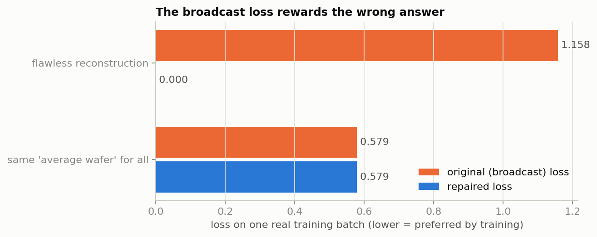
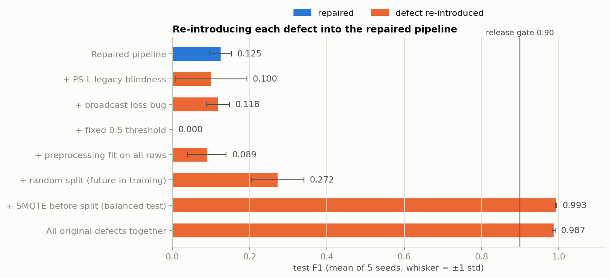
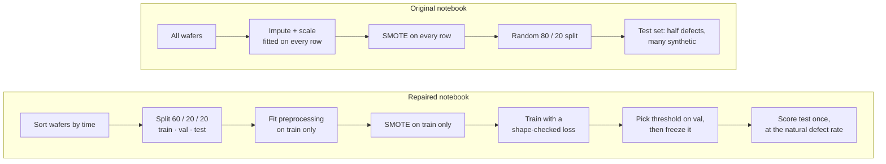
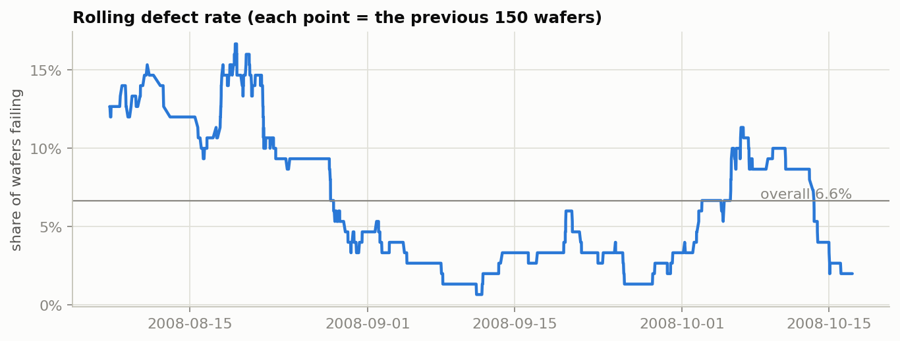
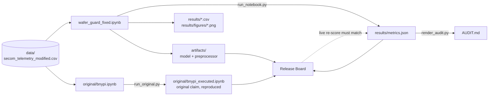

<p align="center">
  
</p>

# Wafer Guard: Audit & Repair of the Fab-7 Wafer Anomaly Detector

<p align="center">
  GDG on Campus VIT Vellore · Tech Wildcard Entry · AI / Machine Learning task
</p>

We were handed a PyTorch notebook that flags defective semiconductor wafers. It reported an F1 above 0.90
and was about to go to production. Before signing off, we wanted to know where that score came from.

The short answer: from the way it was tested. The model had been graded on an exam it had partly seen,
its loss function was quietly comparing the wrong tensors, and one probe station's error codes were being
read as sensor measurements. This repo reproduces the original claim, shows the evidence for each problem,
fixes them without retuning anything, and then measures what the model can really do on wafers it has
never seen, at the defect rate the fab actually runs at.

Spoiler: it doesn't pass the release gate. That's the finding, and the [audit](AUDIT.md) explains why.

| What you're looking for | Where it is |
|---|---|
| The repaired notebook (start here) | [`wafer_guard_fixed.ipynb`](wafer_guard_fixed.ipynb) |
| Findings, metrics and the go / no-go call | [`AUDIT.md`](AUDIT.md) |
| Every number the project reports | [`results/metrics.json`](results/metrics.json) |
| The interactive Release Board | [`app/release_board.py`](app/release_board.py) |

## What was wrong

**1. The test set leaked.** The original oversampled defects with SMOTE *before* splitting the data. SMOTE
makes new defect rows by blending real ones, so after a random split many test defects had a near-twin in
the training set, built partly from themselves. The test set also ended up half defects, which is nothing
like a real line. On top of that, the split ignored time (training saw wafers from the future) and the
imputer and scaler were fitted on every row, test rows included.

**2. The reconstruction loss was broadcasting.** Inputs came out of the data loader as `[B, 1, F]`, the
decoder returned `[B, F]`, and `reconstructed - batch_x` doesn't fail in PyTorch. It silently becomes
`[B, B, F]` and compares every reconstruction against every input in the batch. Under that loss, outputting
one "average wafer" for everybody scores better than a perfect reconstruction:

<p align="center">
  
</p>

**3. Legacy probe station PS-L was invisible.** Wafers from the old PS-L station write `0.0` into
`sensor_0` as a placeholder and put firmware error codes (`100`, `200`, `300`) into `sensor_1`. The
original treated those as real readings, so they dragged the imputer's fill value and blew up the
scaler's spread for both sensors.

There was a fourth, smaller one: a fixed 0.5 decision threshold on a model whose scores mostly sit far
below that.

## How much of the 0.90 each bug explains

To pin down blame, we took the repaired pipeline and switched each original defect back on, one at a
time, with five training seeds per setting. Nothing gets near the gate unless SMOTE runs before the
split:

<p align="center">
  
</p>

The broadcast bug barely moves F1, which is exactly why it's dangerous: the headline metric doesn't see
it, but the decoder has stopped reconstructing anything. The ablation table in [`AUDIT.md`](AUDIT.md)
shows this in the reconstruction-spread column.

## How the repair works

Here's the data flow before and after. The model itself (architecture, optimiser, epochs, learning rate)
is untouched, so any change in the score comes from the fixes, not from tuning.



A few details that matter:

- Wafers that share a timestamp are never split across two blocks.
- `WaferPreprocessor` learns which sensors to keep, their means and their spreads from training wafers
  only, then applies those frozen numbers to everything later, the same way it would run in production.
- For PS-L wafers, the placeholder and the error codes are pulled out of the continuous columns before
  any statistic is computed. The station becomes an explicit `ps_l_legacy` flag and the code becomes
  three one-hot columns (`ps_l_fw_code_100/200/300`). Nothing is imputed over them.
- `reconstruction_loss` flattens the target to `[B, F]` and asserts the shapes match. If they ever
  don't, training stops instead of quietly learning the wrong thing.

Time order matters here because the defect rate isn't stable. It drifts month to month, so a random
split mixes easy and hard periods and flatters the model:

<p align="center">
  
</p>

## Where the numbers come from

Nobody typed a metric into this repo. The repaired notebook measures everything and writes it to
`results/metrics.json`. `AUDIT.md` is rendered from that file by a script, and the Release Board only
reads it. The board also reloads the saved model, re-scores every wafer on the spot and checks the
result against `metrics.json`, so if the files and the model ever disagree, you'll see it on screen.



The evaluator-only file in the task's Drive folder (`secom_legacy_mask_EVALUATOR_ONLY.csv`) was never
downloaded or used. PS-L wafers are found from the rule in the brief, and the notebook checks that rule
against the data before relying on it.

## Prerequisites

- Python 3.11 or newer. The committed results were produced with Python 3.13 on a CPU; no GPU needed.
- About 1 GB of free disk space, mostly for PyTorch.

## Installation

```bash
python -m venv .venv
# Windows: .venv\Scripts\activate      macOS/Linux: source .venv/bin/activate
pip install -r requirements.txt
python -m ipykernel install --user --name python3
```

## Reproduce everything

The whole thing takes about ten minutes on a laptop CPU. Run from the repo root:

```bash
python scripts/run_original.py     # 1. reproduce the original claim  -> original/bnypi_executed.ipynb
python scripts/run_notebook.py     # 2. run the repaired pipeline     -> results/, artifacts/
python scripts/render_audit.py     # 3. regenerate the audit          -> AUDIT.md
streamlit run app/release_board.py # 4. open the Release Board
```

`python scripts/run_pipeline.py` runs steps 1 to 3 in one go; it's also what the board's
**Run pipeline** button calls. You can open `wafer_guard_fixed.ipynb` in Jupyter, VS Code or Colab and run
all cells instead. On Colab, upload `data/secom_telemetry_modified.csv` into a `data/` folder first.

Seeds are fixed, so a rerun on the same library versions gives the same numbers on CPU. We checked this
by running the full pipeline from an empty `results/` folder and comparing: `metrics.json`, both CSVs,
`AUDIT.md` and the model weights came out identical.

## The Release Board

A Streamlit dashboard for the release meeting. It has an overview with the gate decision, model
performance, data drift and the PS-L breakdown, the ablation study, walk-forward folds, a wafer explorer
that shows how the live model scores each wafer, the audit evidence, the configuration that produced the
results, and a page to rerun the pipeline and watch its log.

## Configuration

The main switches sit at the top of the notebook, in **§0 Setup**:

| Setting | What it controls |
|---|---|
| `HP` | Model and training hyper-parameters, copied unchanged from the original |
| `SEED`, `EVAL_SEEDS` | The seed of the saved model, and the extra seeds used to measure variation |
| `SPLIT_FRACTIONS` | Train / validation / test shares, taken in time order (60 / 20 / 20) |
| `CLIP_Z` | Standardised values are capped at ± this many σ (5) |
| `LEGACY_CODES` | The PS-L firmware codes from the brief |
| `GATE_F1` | The release gate the original used (0.90) |

A few smaller settings live next to the code that uses them: the number of walk-forward folds (§6), the
logistic-regression regularisation grid (§5.3) and the number of bootstrap resamples (§5.2). The §0
values are saved under `config` in `metrics.json`, and the board's Configuration page shows them.

## Testing

The pipeline checks itself while it runs and stops with an error if any of these fail:

- every PS-L error code appears only on PS-L wafers, and every PS-L wafer carries one (§1.1);
- train comes before validation, which comes before test, with no timestamp shared across a boundary (§4.1);
- reconstruction and input shapes match, and logits match labels, on every training batch (§4.3);
- the validation block contains at least one defect before a threshold is tuned on it (§4.4).

On top of that, the Release Board's **Reproduce** page compares the live re-score of the saved model
against `metrics.json` metric by metric, and flags any difference in the top bar.

## Design decisions and limitations

- **Fix, don't tune.** Architecture, optimiser, epochs and learning rate are the original's. We only
  removed defects, so the before/after comparison is fair.
- **The threshold is chosen on validation, then frozen.** The validation block doesn't hold many defects,
  so the threshold is noisy. We report that rather than hide it.
- **Clipping at ±5σ and dropping sensors that are constant in training** are production-hardening
  choices. Both were fixed before we looked at any test result.
- **The test set is small.** With few defects in the most recent block, confidence intervals are wide.
  That's why walk-forward evaluation and five seeds are reported next to the single hold-out.
- **PS-L wafers never fail in this data.** The model could easily learn "PS-L means pass", and how it
  would handle a real PS-L failure is untested.
- **A simpler model does about as well.** The notebook trains a logistic-regression baseline on the same
  features as a reference point. The comparison is in `AUDIT.md`.

## Project layout

```
wafer-guard/
├── wafer_guard_fixed.ipynb      # the repaired pipeline (read this first)
├── AUDIT.md                     # generated audit report
├── data/secom_telemetry_modified.csv
├── original/
│   ├── bnypi.ipynb              # notebook as supplied
│   └── bnypi_executed.ipynb     # the same notebook, executed by us (evidence of the original claim)
├── results/
│   ├── metrics.json             # every number, written by the notebook
│   ├── ablation_runs.csv        # bug-attribution runs (8 configurations × 5 seeds)
│   ├── walk_forward.csv
│   └── figures/*.png
├── artifacts/                   # repaired model weights + fitted preprocessor
├── app/
│   ├── release_board.py         # Streamlit dashboard
│   └── inference.py             # loads artifacts/ and re-scores wafers for the dashboard
├── scripts/
│   ├── run_original.py          # executes the original notebook unchanged
│   ├── run_notebook.py          # executes wafer_guard_fixed.ipynb top to bottom
│   ├── render_audit.py          # metrics.json -> AUDIT.md
│   └── run_pipeline.py          # runs the three steps above in order (the board's Run pipeline button)
├── assets/logo.svg
└── .streamlit/config.toml
```

## Libraries, data and assets

PyTorch, scikit-learn, imbalanced-learn (SMOTE), pandas, NumPy, Matplotlib, joblib, Streamlit, Altair,
and nbformat / nbclient for running the notebooks headless. Exact versions are pinned in
`requirements.txt`.

The dataset is the task's `secom_telemetry_modified.csv`, a modified version of the UCI SECOM dataset.
The logo in `assets/` was made for this project. The dashboard uses the IBM Plex fonts from Google Fonts.
